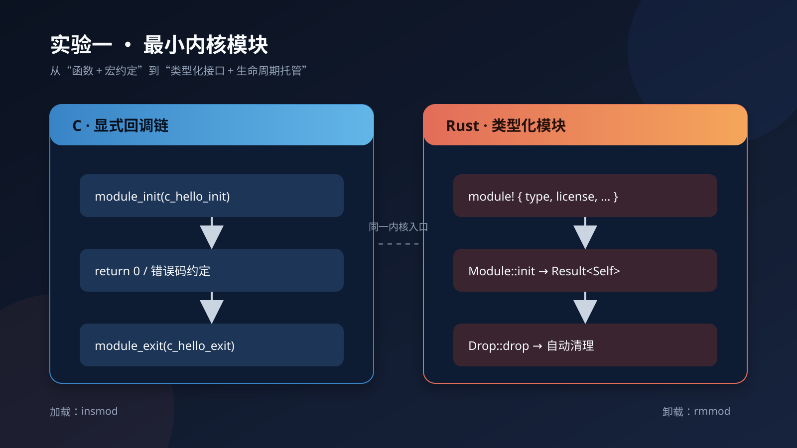
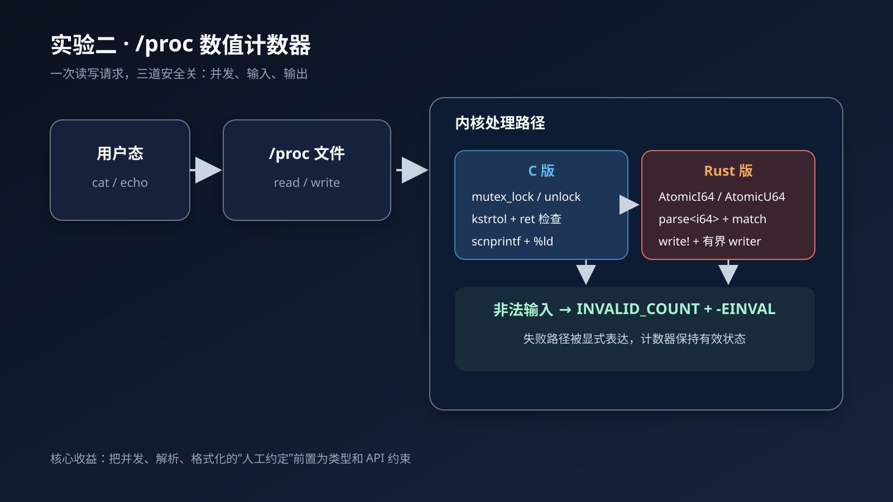
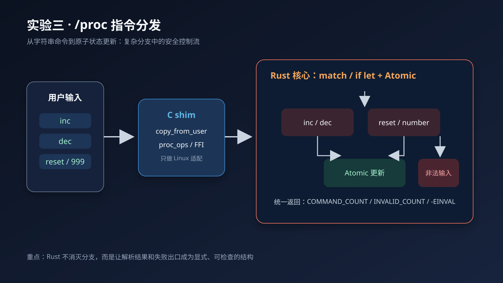
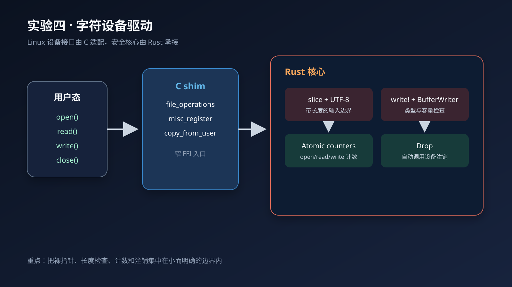

# Rust 相比 C 的内核实验代码对比

这份材料对应仓库中的 8 个实验：C 版实验 `01`～`04`，Rust 版实验 `05`～`08`，按功能两两对应。目标是给 PPT 提供“少量代码 + 清晰结论”，不重复展示完整工程。

## 如何使用

- 每组建议做 1～2 页：第一页放左、右两段关键代码，第二页放结论和流程图。
- 代码行号按当前仓库文件标注；`*.mod.c` 等构建生成文件不作为讲解对象。
- Rust 版实验保留了少量 C shim：shim 负责 Linux 的 `proc_ops`/`file_operations`、`copy_from_user` 和设备注册，Rust 负责核心状态与逻辑。这个边界本身就是“渐进式引入 Rust”的架构特点。
- 文档中的“更安全”指编译器和类型系统减少了可犯的错误；跨 FFI、裸指针和 `unsafe` 代码仍然需要人工审查。

## 总览

| 组 | C 实验 | Rust 实验 | 共同功能 | PPT 主线 |
|---|---|---|---|---|
| 1 | `01-c-hello/c_hello.c` | `05-rust-hello/rust_hello.rs` | 最小内核模块 | 模块元数据、初始化结果、卸载清理 |
| 2 | `02-c-proc-counter/c_proc_counter.c` | `06-rust-proc-counter/rust_proc_counter_core.rs` | `/proc` 数值读写 | 手动互斥锁 vs 原子类型；错误码 vs `Result`；格式化边界 |
| 3 | `03-c-proc-command/c_proc_command.c` | `07-rust-proc-command/rust_proc_command_core.rs` | `/proc` 指令分发 | 字符串分支、输入解析、复杂控制流下的资源管理 |
| 4 | `04-c-char-device/c_char_device.c` | `08-rust-char-device/rust_char_device_core.rs` | 字符设备读写（接口相同，业务语义有差异） | 接口抽象、切片边界、原子计数、RAII |

---

## 第一组：最小内核模块

### 1.1 讲解目标

用最小代码说明 Rust 把模块元数据、初始化返回值和卸载动作组织成类型化接口。C 版是几个独立宏和两个独立回调；Rust 版是 `module!` + `Module` trait + `Drop`。

### 1.2 建议展示的代码

**C：分散的回调和宏注册**（[`01-c-hello/c_hello.c`](01-c-hello/c_hello.c)，第 5–21 行）

```c
static int __init c_hello_init(void)
{
    pr_info("c_hello: module loaded, jiffies=%lu\n", jiffies);
    return 0;
}

static void __exit c_hello_exit(void)
{
    pr_info("c_hello: module unloaded\n");
}

module_init(c_hello_init);
module_exit(c_hello_exit);
MODULE_LICENSE("GPL");
MODULE_AUTHOR("student");
```

**Rust：元数据和模块接口集中声明**（[`05-rust-hello/rust_hello.rs`](05-rust-hello/rust_hello.rs)，第 7–28 行）

```rust
module! {
    type: RustHello,
    name: "rust_hello",
    author: "student",
    description: "A simple openEuler kernel module written in Rust",
    license: "GPL",
}

impl kernel::Module for RustHello {
    fn init(_module: &'static ThisModule) -> Result<Self> {
        pr_info!("rust_hello: module loaded\n");
        Ok(RustHello)
    }
}

impl Drop for RustHello {
    fn drop(&mut self) {
        pr_info!("rust_hello: module unloaded\n");
    }
}
```

### 1.3 讲解要点

1. **初始化结果有明确类型**：C 用 `int`，约定 `0` 成功；Rust 返回 `Result<Self>`，成功路径必须构造 `Ok(RustHello)`，失败可以返回内核错误。
2. **接口由 trait 约束**：`impl kernel::Module for RustHello` 让模块必须满足内核模块接口，而不是靠多个宏和函数名约定拼接。
3. **清理与对象生命周期绑定**：C 需要额外的 `module_exit` 和 `c_hello_exit`；Rust 的 `Drop` 在模块对象销毁时运行。复杂模块中，清理逻辑不容易因为漏写卸载回调而被遗忘。
4. **不要夸大为“完全自动安全”**：`Drop` 只保证 Rust 对象生命周期内的清理调用，外部资源的注销函数本身仍要正确实现。

### 1.4 流程图



成品图文件：[`diagrams/01-module-lifecycle.svg`](diagrams/01-module-lifecycle.svg)

**一句话结论**：C 把“成功、注册、清理”分散在约定中；Rust 把它们收进类型化的模块接口和对象生命周期。

---

## 第二组：`/proc` 数值计数器

### 2.1 讲解目标

这组最适合突出三个 Rust 特性：原子类型、模式匹配解析、格式化宏。C 版必须显式维护互斥锁、缓冲区和错误码；Rust 版把并发状态和输入结果表达成类型。

### 2.2 并发状态：锁维护 vs 原子操作

**C：读写计数器时手动加锁**（[`02-c-proc-counter/c_proc_counter.c`](02-c-proc-counter/c_proc_counter.c)，第 12–18、29–42、65–68 行）

```c
static long counter;
static unsigned long read_count;
static unsigned long write_count;
static DEFINE_MUTEX(counter_lock);

mutex_lock(&counter_lock);
read_count++;
/* 读取并格式化共享状态 */
mutex_unlock(&counter_lock);

mutex_lock(&counter_lock);
counter = value;
write_count++;
mutex_unlock(&counter_lock);
```

**Rust：用原子类型表达共享计数**（[`06-rust-proc-counter/rust_proc_counter_core.rs`](06-rust-proc-counter/rust_proc_counter_core.rs)，第 24–27、69–78、99–109 行）

```rust
static COUNTER: AtomicI64 = AtomicI64::new(0);
static READ_COUNT: AtomicU64 = AtomicU64::new(0);
static WRITE_COUNT: AtomicU64 = AtomicU64::new(0);
static INVALID_COUNT: AtomicU64 = AtomicU64::new(0);

let read_count = READ_COUNT.fetch_add(1, Ordering::Relaxed) + 1;
/* write! 读取 COUNTER、WRITE_COUNT、INVALID_COUNT */

COUNTER.store(value, Ordering::Relaxed);
WRITE_COUNT.fetch_add(1, Ordering::Relaxed);
```

**可讲的优势**：这个实验的计数器操作只需要原子读、写、加，不需要锁的所有权和解锁路径，因此少了一类“分支提前返回导致忘记解锁”的风险。要准确表述为“在这个计数器场景下适合无锁原子操作”，不要说原子类型能解决所有并发问题。

### 2.3 输入解析：返回码检查 vs `match`

**C：缓冲区、拷贝、解析和错误码都由调用者维护**（[`02-c-proc-counter/c_proc_counter.c`](02-c-proc-counter/c_proc_counter.c)，第 49–68 行）

```c
char kbuf[32];
long value;
int ret;

if (count == 0 || count >= sizeof(kbuf))
    return -EINVAL;
if (copy_from_user(kbuf, buf, count))
    return -EFAULT;
kbuf[count] = '\0';

ret = kstrtol(kbuf, 10, &value);
if (ret)
    return ret;
counter = value;
```

**Rust：解析结果直接分成成功和失败两条路径**（[`06-rust-proc-counter/rust_proc_counter_core.rs`](06-rust-proc-counter/rust_proc_counter_core.rs)，第 90–111 行）

```rust
let bytes = unsafe { slice::from_raw_parts(buf as *const u8, len) };
let input = match str::from_utf8(bytes) {
    Ok(s) => s.trim(),
    Err(_) => {
        INVALID_COUNT.fetch_add(1, Ordering::Relaxed);
        return EINVAL_NEG;
    }
};

match input.parse::<i64>() {
    Ok(value) => {
        COUNTER.store(value, Ordering::Relaxed);
        WRITE_COUNT.fetch_add(1, Ordering::Relaxed);
        len as c_long
    }
    Err(_) => {
        INVALID_COUNT.fetch_add(1, Ordering::Relaxed);
        EINVAL_NEG
    }
}
```

**可讲的优势**：`Result` 让“可能失败”成为返回值的一部分，`match` 明确覆盖 `Ok`/`Err`。Rust 并不会替程序决定业务策略，但会让遗漏分支更难通过编译。

### 2.4 输出与边界：`scnprintf` vs `write!` + 有界 writer

**C：格式字符串和参数由人工保持一致**（[`02-c-proc-counter/c_proc_counter.c`](02-c-proc-counter/c_proc_counter.c)，第 32–39 行）

```c
len = scnprintf(kbuf, sizeof(kbuf),
                "counter = %ld\n"
                "read_count = %lu\n"
                "write_count = %lu\n",
                counter, read_count, write_count);
```

**Rust：格式化宏调用自定义的有界 writer**（[`06-rust-proc-counter/rust_proc_counter_core.rs`](06-rust-proc-counter/rust_proc_counter_core.rs)，第 43–60、72–81 行）

```rust
impl Write for KernelBuf {
    fn write_str(&mut self, s: &str) -> fmt::Result {
        let bytes = s.as_bytes();
        if self.len + bytes.len() > self.cap {
            return Err(fmt::Error);
        }
        unsafe { core::ptr::copy_nonoverlapping(
            bytes.as_ptr(), self.ptr.add(self.len), bytes.len()
        ); }
        self.len += bytes.len();
        Ok(())
    }
}

let _ = write!(&mut out, "counter = {}\n", COUNTER.load(Ordering::Relaxed));
```

**可讲的优势**：`write!` 使用 Rust 的格式化 trait，参数类型不匹配会在编译阶段暴露；`KernelBuf` 又在运行时检查剩余容量。这里仍有一个明确的 `unsafe` 边界，所以重点是“危险操作集中且有边界检查”，而不是“Rust 不需要指针审查”。

### 2.5 流程图



成品图文件：[`diagrams/02-proc-counter.svg`](diagrams/02-proc-counter.svg)

**一句话结论**：同一个 `/proc` 接口下，Rust 把共享状态、失败路径和格式化边界都变成了可检查的程序结构。

---

## 第三组：`/proc` 指令分发

### 3.1 讲解目标

这是第二组的进阶版：输入不再只有数字，而是 `inc`、`dec`、`reset` 或数字。重点放在复杂分支中的原子更新、`if let Ok(value)` 和统一失败出口。

### 3.2 指令分发：锁包围的多分支 vs 原子更新

**C：先锁住，再维护多条 `strcmp` 分支**（[`03-c-proc-command/c_proc_command.c`](03-c-proc-command/c_proc_command.c)，第 77–107 行）

```c
mutex_lock(&counter_lock);
write_count++;

if (strcmp(kbuf, "inc") == 0) {
    counter++;
    command_count++;
} else if (strcmp(kbuf, "dec") == 0) {
    counter--;
    command_count++;
} else if (strcmp(kbuf, "reset") == 0) {
    counter = 0;
    command_count++;
} else {
    ret = kstrtol(kbuf, 10, &value);
    if (ret == 0) {
        counter = value;
        command_count++;
    } else {
        invalid_count++;
        mutex_unlock(&counter_lock);
        return -EINVAL;
    }
}

mutex_unlock(&counter_lock);
```

**Rust：每个状态改变都通过原子操作，数字解析用 `if let`**（[`07-rust-proc-command/rust_proc_command_core.rs`](07-rust-proc-command/rust_proc_command_core.rs)，第 102–131 行）

```rust
if input == "inc" {
    COUNTER.fetch_add(1, Ordering::Relaxed);
} else if input == "dec" {
    COUNTER.fetch_sub(1, Ordering::Relaxed);
} else if input == "reset" {
    COUNTER.store(0, Ordering::Relaxed);
} else if let Ok(value) = input.parse::<i64>() {
    COUNTER.store(value, Ordering::Relaxed);
} else {
    INVALID_COUNT.fetch_add(1, Ordering::Relaxed);
    pr_info!("rust_proc_command: invalid input\n");
    return -EINVAL;
}

COMMAND_COUNT.fetch_add(1, Ordering::Relaxed);
len as c_long
```

### 3.3 讲解要点

1. **并发控制更贴合操作粒度**：`fetch_add`/`fetch_sub`/`store` 直接表达计数器操作，减少一段长临界区需要维护的锁状态。
2. **解析与取值合并**：`else if let Ok(value)` 同时完成“尝试解析”和“成功后绑定值”；失败自然进入统一 `else`。
3. **错误出口集中**：Rust 的失败分支会增加 `INVALID_COUNT` 并返回错误；C 也可以写得正确，但正确性依赖每条分支都补齐解锁和返回码处理。
4. **不要把 `if-else` 本身说成 Rust 独有优势**：两种语言都能写分支。Rust 的优势在于 `Result`、类型约束和原子 API 让遗漏错误处理的空间更小。

### 3.4 FFI 架构图



成品图文件：[`diagrams/03-proc-command.svg`](diagrams/03-proc-command.svg)

**一句话结论**：指令越复杂，C 中“锁 + 多分支 + 错误码”的维护成本越高；Rust 让状态更新和解析失败路径保持局部、显式。

---

## 第四组：字符设备驱动

### 4.1 讲解目标

这是最接近设备接口的一组，适合集中展示四件事：trait/函数指针接口、切片和长度、格式化边界、原子计数与 `Drop` 清理。

先说明一个源代码事实：C 版的 `write` 保存用户输入的消息（`message`），Rust 版的 `write` 解析 `inc`、`dec`、`reset` 或数字并更新 `COUNTER`。因此本组适合比较“字符设备接口和安全边界如何实现”，不宜把两版输出的业务字段说成完全相同。

### 4.2 设备接口：裸函数指针 vs FFI shim + Rust 核心

**C：手动填充 `file_operations`**（[`04-c-char-device/c_char_device.c`](04-c-char-device/c_char_device.c)，第 105–118 行）

```c
static const struct file_operations os_lab_fops = {
    .owner = THIS_MODULE,
    .open = os_lab_open,
    .release = os_lab_release,
    .read = os_lab_read,
    .write = os_lab_write,
};

static struct miscdevice os_lab_misc_device = {
    .minor = MISC_DYNAMIC_MINOR,
    .name = DEVICE_NAME,
    .fops = &os_lab_fops,
    .mode = 0666,
};
```

**Rust 版：C shim 保留 Linux 适配，Rust 暴露窄的 FFI 函数**（[`08-rust-char-device/char_shim.c`](08-rust-char-device/char_shim.c)，第 62–84 行；[`08-rust-char-device/rust_char_device_core.rs`](08-rust-char-device/rust_char_device_core.rs)，第 134–153 行）

```c
static const struct file_operations lab_fops = {
    .owner = THIS_MODULE,
    .open = lab_open,
    .read = lab_read,
    .write = lab_write,
    .release = lab_release,
};

int rust_char_device_init(void) { return misc_register(&lab_misc_device); }
void rust_char_device_exit(void) { misc_deregister(&lab_misc_device); }
```

```rust
impl kernel::Module for RustCharDevice {
    fn init(_module: &'static ThisModule) -> Result<Self> {
        let ret = unsafe { rust_char_device_init() };
        if ret != 0 { return Err(ENOMEM); }
        Ok(RustCharDevice)
    }
}

impl Drop for RustCharDevice {
    fn drop(&mut self) {
        unsafe { rust_char_device_exit(); }
    }
}
```

**可讲的优势**：Rust 的核心状态不直接暴露 `file_operations` 裸表，而是通过少量明确的 `extern "C"` 函数和 `Module`/`Drop` 接口连接内核。这样能缩小需要人工审查的 FFI 边界；shim 本身仍是 C，不能省略审查。

### 4.3 写入边界：数组检查 vs 带长度切片

**C：每一步都由调用者手动保证**（[`04-c-char-device/c_char_device.c`](04-c-char-device/c_char_device.c)，第 79–99 行）

```c
char kbuf[MESSAGE_SIZE];
if (count == 0)
    return 0;
if (count >= sizeof(kbuf))
    return -EINVAL;
if (copy_from_user(kbuf, buf, count))
    return -EFAULT;
kbuf[count] = '\0';
strip_newline(kbuf);
strscpy(message, kbuf, sizeof(message));
```

**Rust：先在 FFI 边界验证，再建立带长度的 slice**（[`08-rust-char-device/rust_char_device_core.rs`](08-rust-char-device/rust_char_device_core.rs)，第 99–131 行）

```rust
if buf.is_null() || len == 0 {
    return -EINVAL;
}

let bytes = unsafe { slice::from_raw_parts(buf as *const u8, len) };
let input = match str::from_utf8(bytes) {
    Ok(s) => s.trim(),
    Err(_) => {
        INVALID_COUNT.fetch_add(1, Ordering::Relaxed);
        return -EINVAL;
    }
};
```

**可讲的优势**：slice 携带长度，后续字符串操作不再依赖 `\0` 扫描；UTF-8 校验又把字节输入转为合法 `&str`。需要强调：`from_raw_parts` 是 `unsafe`，指针和长度的有效性仍由调用边界保证，Rust 的收益是把这段风险集中在一个小范围内。

### 4.4 输出、并发与清理

**Rust 的三段关键代码**（[`08-rust-char-device/rust_char_device_core.rs`](08-rust-char-device/rust_char_device_core.rs)，第 47–60、64–72、85–96、146–153 行）

```rust
impl Write for BufferWriter {
    fn write_str(&mut self, s: &str) -> fmt::Result {
        let bytes = s.as_bytes();
        if self.len + bytes.len() > self.capacity {
            return Err(fmt::Error);
        }
        unsafe { core::ptr::copy_nonoverlapping(
            bytes.as_ptr(), self.ptr.add(self.len), bytes.len()
        ); }
        self.len += bytes.len();
        Ok(())
    }
}

OPEN_COUNT.fetch_add(1, Ordering::Relaxed);
RELEASE_COUNT.fetch_add(1, Ordering::Relaxed);

let _ = write!(
    out,
    "open_count = {}\nrelease_count = {}\n",
    OPEN_COUNT.load(Ordering::Relaxed),
    RELEASE_COUNT.load(Ordering::Relaxed),
);

impl Drop for RustCharDevice {
    fn drop(&mut self) {
        unsafe { rust_char_device_exit(); }
    }
}
```

对应的 C 代码在 [`04-c-char-device/c_char_device.c`](04-c-char-device/c_char_device.c) 第 31–49、60–74、120–140 行：`mutex_lock`/`mutex_unlock` 包围计数器，`scnprintf` 负责输出，`misc_deregister` 在显式 `__exit` 中注销设备。

### 4.5 流程图



成品图文件：[`diagrams/04-char-device.svg`](diagrams/04-char-device.svg)

**一句话结论**：字符设备中，Rust 将接口适配、输入边界、格式化输出、计数器和注销动作分成更小的可检查单元，降低裸指针和手动资源管理的扩散范围。

---

## 最后可放在 PPT 结尾的一页

| 风险点 | C 版主要责任 | Rust 版对应机制 | 能准确说出的优势 |
|---|---|---|---|
| 模块初始化/卸载 | 函数名、宏和返回码约定 | `Module`、`Result`、`Drop` | 接口和生命周期更集中 |
| 共享计数器 | 手动 `mutex_lock`/`unlock` | `Atomic*` + `Ordering` | 计数器场景下减少锁维护和死锁路径 |
| 用户输入 | 数组、NUL、错误码逐项检查 | slice、UTF-8、`match`/`if let` | 失败路径更显式，长度信息不易丢失 |
| 文本输出 | `scnprintf` 占位符与参数配对 | `write!` + `Write` trait + 容量检查 | 类型和缓冲区边界更早暴露问题 |
| 设备注册 | 手动函数指针表和注销 | C shim + 窄 FFI + `Drop` | 缩小危险接口的审查范围 |

### 汇报时建议使用的总括句

> C 语言能直接完成同样的内核功能，但很多安全条件靠程序员在每个分支里手动维护；Rust 把其中一部分条件提升为类型、trait、原子 API 和生命周期规则，让错误更早暴露，且保留了通过 FFI 与现有 Linux 内核接口协作的能力。

### 不建议在 PPT 中绝对化的表述

- 不要说“Rust 完全没有 `unsafe`”：本仓库的 Rust 代码在 FFI、裸指针和 `from_raw_parts` 处仍使用 `unsafe`。
- 不要说“Atomic 能替代所有锁”：它只适合本实验这类独立计数器的原子读改写；复合不变量仍可能需要锁。
- 不要说“C 的格式字符串永远不检查”：编译器/内核宏可能提供部分检查，但 Rust 的格式化参数由类型系统直接约束，表达更统一。

